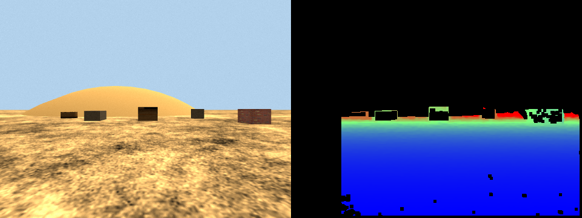
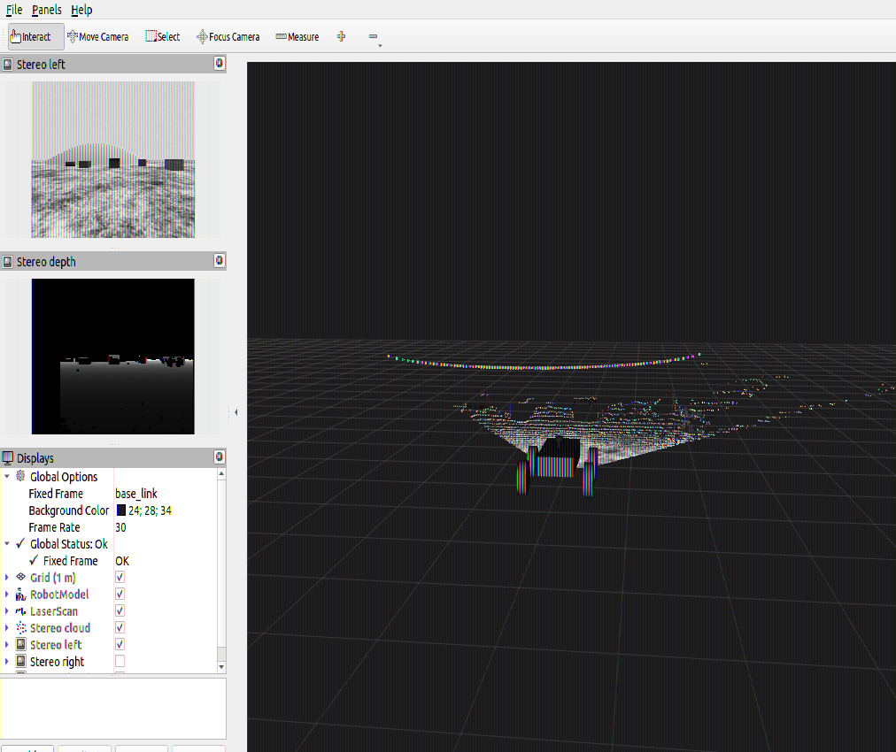

# Stereo camera validation

Run on 2026-10-17. Setup: Ubuntu 22.04, ROS 2 Humble, Gazebo Classic 11.10.2;
Intel i7-14700HX (28 threads) with Intel integrated-GPU rendering through Mesa
(the NVIDIA driver was not loaded). Each check used a dedicated headless
simulation: ROS domain 47, Gazebo master port 11357, shutdown checks on domain
46. Design and usage: [stereo guide](../stereo.md).

**Result: all checks pass at the shipped defaults** (480 × 360, 15 Hz,
0.12 m baseline, 90° FOV): 280/280 unit tests and 63/63 integration checks.
Getting there took two design changes, four fixes to the new validator's own
checks, and one fix to a shutdown bug in the new nodes. All are listed below.

## Unit tests

`colcon test` reports 291 results with 0 failures: 280 pytest cases plus 11
CTest wrappers. That is the 131 existing tests plus 149 new ones:

| File | Tests | Covers |
| --- | --- | --- |
| `test_stereo_geometry.py` | 33 | intrinsics, camera_info / Tx, baseline from URDF, keep-out maths |
| `test_stereo_matching.py` | 51 | image checks, pair consistency, SGBM conversion, texture and edge filters, depth, points, packing |
| `test_stereo_truth.py` | 8 | ray casting (cross-checked with `validate_lidar.py`), world parsing |
| `test_stereo_description.py` | 18 | frames, optical axes, sensor/plugin config, no collision/mass, LiDAR byte-identical, keep-out |
| `test_stereo_nodes.py` | 14 | relay and processor callbacks, fail-closed rejection, repeated-signal shutdown |
| `test_stereo_launch.py` | 17 | all four stereo × LiDAR launch combinations, argument checks, RViz configs |
| `test_stereo_world.py` | 8 | hills/ground unchanged, feature placement rules, material export |

One existing test file changed. The `test_lidar.py` fixture now passes
`enable_stereo=false`, because one LiDAR test asserts "LiDAR off ⇒ no sensors
at all", and the stereo camera (on by default) is also a sensor. All 14 LiDAR
assertions are unchanged.

## Integration checks (63)

| Suite | Checks | Result | Evidence |
| --- | --- | --- | --- |
| Stereo, full run (stereo on) | 11 | pass | [stereo_validation.json](stereo_validation.json) |
| Stereo-off baseline | 4 | pass | [stereo_baseline.json](stereo_baseline.json) |
| Launch combinations (start, data, clean stop) | 4 | pass | [stereo_launch_matrix.json](stereo_launch_matrix.json) |
| Existing LiDAR suite, stereo on | 12 | pass | [stereo_regression_lidar.json](stereo_regression_lidar.json) |
| Existing motion suite incl. blocked strafe, stereo on | 10 | pass | [stereo_regression_motion.json](stereo_regression_motion.json) |
| Existing keyboard suite, stereo on | 10 | pass | [stereo_regression_teleop.json](stereo_regression_teleop.json) |
| Existing hardening suite, stereo on (run 3 times) | 10 | pass ×3 | [run 1](stereo_regression_hardening.json), [2](stereo_regression_hardening_run2.json), [3](stereo_regression_hardening_run3.json) |
| Existing shutdown suite | 2 | pass | [stereo_regression_shutdown.json](stereo_regression_shutdown.json) |

### Performance and non-interference

Three 10-second windows each, measured headless, with no RViz or Gazebo GUI:

| Metric | Stereo off | Stereo on |
| --- | --- | --- |
| Real-time factor (per window) | 0.9990, 0.9991, 0.9990 | 0.9984, 0.9989, 0.9988 |
| Median real-time factor | **0.9990** | **0.9988** (ratio 0.9998; limit ≥ 0.9) |
| Largest controller heartbeat gap | 0.0215 s | 0.0241 s (limit 0.15 s; watchdog 0.3 s unchanged) |
| Watchdog epoch changes | none | none |
| LiDAR rate (simulation time) | 10.0 Hz | 10.0 Hz |
| Resting LiDAR scan, finite returns | 222 | 222 |
| Resting scan per-beam difference | — | median 0.0099 m, p99 0.033 m (noise σ 0.01 m per scan) |
| Left/right image, disparity, depth, cloud rates | — | 15.0 Hz each (simulation time) |
| Processor time per pair | — | 22 ms mean; 150 pairs per 10 s; 0 rejected |

The existing LiDAR suite with stereo on also measured RTF 0.9982–0.9988,
heartbeat gaps ≤ 0.023 s and 10.0 Hz scans. Its hill and probe-box
ground-truth checks pass, so the new world features do not disturb it.

### Interface, sync, camera_info and TF

- Each `/stereo/*` topic has exactly one publisher, with the expected type and
  owner. The stereo nodes publish nothing outside `/stereo/` except `/rosout`
  and `/parameter_events`.
- **506 of 506** left/right frames had identical stamps. Every depth frame
  carries a real capture stamp.
- `fx = fy = 239.9991` (expected 240; Gazebo stores the FOV with float
  precision), `cx = 239.5`, `cy = 179.5`, `D = 0`. Left `Tx = 0`; right
  `Tx = −28.79989 = −fx × 0.12`.
- `base_link → stereo_left_optical_frame` = (0.55, 0.06, −0.03) m and right =
  (0.55, −0.06, −0.03) m, matching the URDF. `robot_state_publisher` is the only
  `/tf_static` publisher; there are no dynamic stereo transforms and no
  odom/map/world frames.

### Depth versus ground truth

The rover was placed at four poses with `gz model`: spawn, 2 m forward, 2 m
back, and yawed 0.35 rad. At each, every 6th pixel of the depth image was
compared with the analytic depth of the ground plane, hills and features along
that pixel's ray. Tolerance per bin: `Z²/(fx·B) × 0.5 px + 0.02 m`.
Results on textured surfaces (sand and features):

| Distance | Samples | Valid | Median \|error\| | 90th percentile | Tolerance | Bin |
| --- | --- | --- | --- | --- | --- | --- |
| 0.4–1 m | 5760 | 69% | 0.002 m | 0.006 m | 0.029 m | pass |
| 1–2 m | 2074 | 75% | 0.009 m | 0.023 m | 0.059 m | pass |
| 2–3 m | 662 | 73% | 0.038 m | 0.074 m | 0.129 m | pass |
| 3–4 m | 373 | 66% | 0.092 m | 0.181 m | 0.233 m | pass |
| 4–5 m | 245 | 67% | 0.171 m | 0.380 m | 0.372 m | pass |
| 5–6 m | 16 | 0% | — | — | 0.545 m | fail |
| 6–8 m | 135 | 44% | 0.464 m | 2.465 m | 0.871 m | fail |

- **Usable range: 0.4–5 m** (required: ≥ 4 m). Counting the untextured hill
  too, the range would be 4 m.
- Gross outliers (error > 3 × tolerance) inside the usable range: 0.09%.
- Sky: **0 of 8,746** sampled pixels got a depth.
- Untextured hill: 1.8% of 1,086 sampled pixels got a depth (0.65 m median
  error), all at its silhouette.
- Features: the sand ground is 72% valid with a 4 mm median error. On the
  features, few pixels get a depth (crate 17%, brick block 32%, stump 30%, rock
  slab and post 1–2%), but where they do, the median error is 2–12 cm (44 cm on
  the stump).
- Point cloud: 13,900–15,100 points per frame. Every point reproduces the depth
  image exactly. Ground points lie at a median world height of 1.2–1.4 mm.

Left: left camera at spawn. Right: depth from 0.4 m (blue) to 6 m (red); black
means no depth.

### RViz

`ros2 launch rover_sim rover_desert.launch.py gui:=false rviz:=true` was run
in a nested Xephyr display. RViz loaded `rover_sensors.rviz` with Global Status
OK; robot, LiDAR scan, stereo cloud, left image and depth were all displayed,
with no RViz errors in the log. The rainbow fringes on the 3D content come from
OpenGL inside Xephyr, not from the data.

## What failed along the way, and what changed

1. **Camera sensor did not load.** Exporting `gazebo_media_path` for the sand
   texture made gazebo_ros *replace* `GAZEBO_RESOURCE_PATH`. That hid Gazebo's
   own `gazebo.material`, so the camera sensor never started. Fix: the materials
   moved into a resource folder exported as `gazebo_model_path`. A test now
   rejects a `gazebo_media_path` export.
2. **Processor was too slow (188 ms per pair).** Assigning `bytes` to a ROS
   `uint8[]` field costs ~70 ms per MB in rclpy Humble. Using `array('B')`
   brought it to 23 ms.
3. **False depth on sky and plain surfaces.** SGBM matched camera noise. A
   texture check (`min_texture` 4.0) and 96, later 80, disparities (to cover the
   nearest ground) fixed it.
4. **Sky criterion failed at 640 × 480** (1.2% of sky pixels had depth vs ≤ 0.5%
   allowed). All of them lay 1–6 px above a silhouette (edge fattening). The
   limit was kept and edge erosion was added. Settings were compared offline on
   recorded images using the validator's own metrics.
5. **Hardening regression at 640 × 480 (design change).** See the
   [guide](../stereo.md#parameters). It failed 6 of 6 runs with 640 × 480
   frames and passed 3 of 3 with stereo off, 1 of 1 rendering-only, 2 of 2 at
   320 × 240, and 8 of 8 at 480 × 360. The defaults became 480 × 360, and the
   launch warns about larger frames. Evidence:
   [stereo_hardening_640x480_failure.json](stereo_hardening_640x480_failure.json).
6. **Validator corrections (checker bugs, not system changes).** These are
   disclosed because they changed check outcomes:
   - `DisparityImage.f`/`.t` are float32, so they are now compared at float32
     precision. They were compared at 1e-9, which only float64 can meet.
   - The sync check now looks only at the span where all streams are being
     received. The validator's own startup and reader queue had been counted
     against the system.
   - The coverage rule now uses **textured surfaces**, as the plan said. It had
     also counted the untextured hill; all-surface results are still recorded.
   - Ground-truth sampling density now scales with image width (80 samples per
     row). The fixed 8-px step left the 3–4 m bin with too few samples at
     480 px. At 480 × 360 before these last two corrections, the usable range
     measured 3 m (the 3–4 m bin was 22% valid on all surfaces with 105 samples).
7. **Shutdown tracebacks in the new nodes.** A second Ctrl+C during teardown
   raised `KeyboardInterrupt` in `destroy_node()`. They now use the
   controller's flag-only signal pattern (`rover_sim/node_runner.py`, unit-tested).

### Intermittent shutdown issues outside the stereo nodes

Each was seen once; both stereo nodes exited cleanly in every run. One
launch-matrix attempt
([stereo_launch_matrix_first_attempt.json](stereo_launch_matrix_first_attempt.json))
had two:

- **Gazebo crash at shutdown.** gzserver aborted while shutting down (`boost
  thread: trying joining itself: Resource deadlock avoided`, then exit −6),
  after every ROS node had already stopped. This is Gazebo's own shutdown
  path. It happened once in about 20 stereo-on shutdowns this session; I cannot
  rule out that camera threads make it more likely.
- **Existing controller killed by a second Ctrl+C.** The unchanged
  `swerve_controller` was killed by a second SIGINT (exit −2) with stereo **off**.

In 8 further start/stop cycles (4 with stereo, 4 without), gzserver exited in
0.21 s each time with no errors, and the re-run launch matrix passed 4/4.
