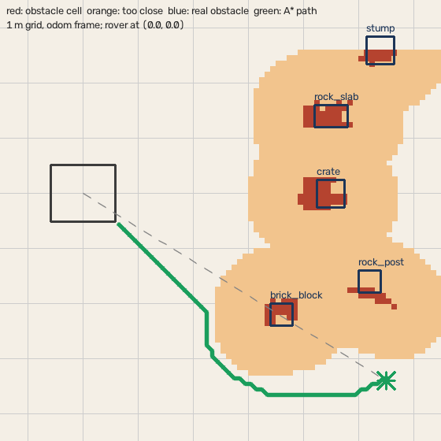

# rover_planner: A* on the stereo camera and 3D LiDAR obstacle grid

Plans a path for the rover_sim rover with the A* search from
`rsx-rover/rover/autonomy/scripts/local_astar.py`. The planner turns the stereo
and 3D LiDAR point clouds into a measured terrain (ground height and slope) and a 2D grid of
obstacles and too-steep ground. A* searches that grid, preferring flatter
ground, and the grid and path are published for RViz. An optional path follower drives the rover along the path.
The planner only reads the simulation's topics; the stereo camera and LiDAR
are untouched.

## Build and run

```bash
cd ~/rover_ws
source /opt/ros/humble/setup.bash
colcon build --base-paths src/rover_sim
source install/setup.bash

# Terminal 1: the simulation (leave its own RViz off; the planner opens one)
ros2 launch rover_sim rover_desert.launch.py

# Terminal 2: the planner, the path follower and the RViz view
source /opt/ros/humble/setup.bash && source ~/rover_ws/install/setup.bash
ros2 launch rover_planner astar_planner.launch.py follow:=true
```

In RViz, pick **2D Goal Pose** in the toolbar and click on the ground; the
rover drives there. Red cells are obstacles, orange cells are places the
rover's centre must not go, the green line is the path, and the left panels
show the stereo left image and depth. Goals without RViz:

```bash
ros2 launch rover_planner astar_planner.launch.py follow:=true goal_x:=5.5 goal_y:=-3.4
ros2 param set /astar_planner goal_x 5.5     # change it while running
```

Without `follow:=true` the planner only draws the path and you drive with
`ros2 run rover_sim rover_teleop`. Do not run teleop while the follower is
driving: both publish `/cmd_vel`. If everything freezes, check that the
simulation is not paused in the Gazebo window.

`--base-paths` keeps colcon out of `src/hand_tracking_project/venv`, which it
otherwise scans and reports errors for.

## How it works

```text
Gazebo ground-truth plugin --/ground_truth/odom--> ground_truth_odom --> /odom + TF odom->base_root
/stereo/points2 --+
/points (3D LiDAR)+-> astar_planner: TF to odom -> elevation map -> ground planes, slope, drop-offs
                    -> height above ground -> obstacle memory
                    -> 12 x 12 m grid around the rover -> grow obstacles and steep ground by footprint
                    -> A* with slope cost
                    --> /planner/grid (OccupancyGrid), /planner/grid_markers, /planner/path (Path),
                        /planner/status (String)
/planner/path + /planner/status + /odom --> path_follower --> /cmd_vel --> rover_sim swerve controller
```

- **Pose.** rover_sim had no odometry or world frame. Its URDF now loads
  Gazebo's `libgazebo_ros_p3d.so` (xacro arg `ground_truth`, default true),
  which publishes the rover's exact pose. `ground_truth_odom` republishes it as
  `/odom` and the `odom -> base_root` TF. `odom` is Gazebo's world frame.
- **Terrain** (`terrain.py`). Each cloud is transformed into `odom` at its
  own timestamp, and the planner measures the ground from it instead of
  assuming z = 0:
  - *elevation map*: every cell's mean point height, blended across clouds and
    weighted by how well stereo measures height at that range;
  - *slope*: a plane fitted over 1 m (about the wheelbase) around each cell
    gives the tilt the rover would have standing there. Cells steeper than
    `max_slope_deg` (25°) are too steep. Gentler slopes cost more the steeper
    they are (`slope_cost` at the limit, growing with the square), so A*
    prefers flat ground;
  - *ground height*: a plane fitted over 2 m, refitted without cells far
    above it so that a rock does not lift the ground under it;
  - *drop-offs*: the camera is 0.30 m above the ground, so ground falling
    away past an edge (a crater rim) is never seen. Cells close in front of
    the camera that were looked at in 3 clouds and still have no height are
    marked too steep.
  Too-steep cells are grown by the same 0.92 m disc as obstacles, because a
  wheel against the foot of a steep wall jams its steering.
- **3D LiDAR** (`/points`, rover_sim's default `lidar_mode:=3d`). The LiDAR
  sees all the way round, so obstacles beside and behind the rover are in the
  grid, and its ranges are accurate (median 4.6 mm against the true terrain).
  It is read at up to `lidar_rate` (10 Hz) out to `lidar_max_range` (10 m),
  and its obstacle cells are drawn with a fixed ±`lidar_range_sigma` (0.03 m)
  instead of stereo's range-squared stretch. Two differences from stereo:
  - LiDAR points above the ground do not go into the elevation map. LiDAR
    hits on a rock's top are dense enough that the rock was otherwise
    measured as a steep bump of terrain instead of an obstacle;
  - it is not used for drop-off detection, which assumes the camera's view.
  Clouds with no LiDAR (`lidar_mode:=2d` or `lidar:=false`) leave the planner
  on stereo alone. Planning with the 3D LiDAR lowers the Mars world's
  real-time factor to about 0.7 (see rover_sim `docs/lidar3d.md`).
- **Obstacles.** Points 0.12-1.5 m above the *local* ground within 6 m of
  the camera are obstacle points, so a hill is ground, not a wall. Points
  near the ground clear old obstacle cells.
- **Obstacle memory** (`occupancy.py`):
  - a cell needs 2 obstacle points in one cloud, and must be seen in 3 clouds
    before it counts. Real obstacles appear in every cloud; stereo mismatches
    rarely repeat, and were otherwise blocking whole areas;
  - a counted cell is cleared only when 3 clouds in a row show ground in it.
    Cells out of view or hidden behind something are kept with no timeout, so
    a parked rover does not forget the rock beside it;
  - stereo depth error grows with range squared and lies along the camera
    ray, so each cell is drawn stretched ±σ along that ray, σ = 0.0087 × r²
    (±0.14 m at 4 m, ±0.23 m at 5.2 m). Near obstacles stay tight; far ones,
    whose position is less certain, get longer.
- **A\*** (`astar.py`) is the original search: 8 neighbours, step cost 1 or
  1.414 plus the height cost (|height change| + 1), Euclidean heuristic, and
  the "can the rover stand on the goal" pre-check. Changed:
  - the footprint test. The original checked the rover's four corners per
    step, which misses obstacles smaller than the rover between them. The
    obstacle mask is now grown once per plan by a disc of radius 0.92 m (the
    rover's half diagonal, 0.77 m, plus 0.15 m clearance). rover_sim's
    controller does not let the rover move sideways, so it turns to follow a
    path, and a disc fits every heading. (`footprint_shape: rectangle` uses
    the rectangle at the current heading instead.)
  - stepping out of the margin. Following a path that hugs the margin, or a
    newly seen obstacle, can leave the rover's centre just inside it, where
    the original search could never start. If the rover's real body (no
    clearance, real heading) touches nothing, the path starts with a short
    straight step to the nearest free cell, checked against the real body.
    If the real body does touch an obstacle, there is no path and the rover
    stops.
- **Path follower** (`path_follower.py`, settings in
  `config/path_follower.yaml`): turn-then-drive like the original's
  `navigate()`. It aims 0.5 m along the path; more than 30° off the nose it
  turns in place, otherwise it drives at up to 0.4 m/s (teleop's speed),
  steering towards that point and slowing within 0.6 m of the end. It stops
  when the path is empty (goal reached or unreachable) or when the path or
  pose is more than 1 s old. It publishes at 10 Hz while driving and nothing
  when idle; rover_sim's controller stops the rover 0.5 s after the last
  command, so the rover also stops if the follower dies.
- **Looking around when stuck.** A false obstacle or drop-off behind the
  camera can close the only way on, for example in the crater gully, which
  is about 3 m wide. Remembered cells are cleared only by seeing ground
  there, so without help the rover would wait forever. When there is a goal
  but no path, the planner publishes `no_path_can_turn` on `/planner/status`
  if turning in place is safe: no obstacle under the rover's 0.77 m corner
  disc, and the rover standing on drivable ground. (Steep ground under the
  disc does not count; counting it once left the rover stuck beside a crater
  wall.)
  Otherwise it publishes `no_path`. After 2 s of `no_path_can_turn`, the
  follower turns in place at 0.3 rad/s, for at most one full turn, so that the
  camera re-checks the ground around the rover. It stops turning as soon as a
  path appears. It looks around only once until the rover has driven 1 m
  (`scan_travel`) from where the last look-around started, or the goal is
  reached or changed; without this limit a path that kept appearing and
  vanishing made the rover go, stop and spin over and over.
- **RViz** shows the grid with `/planner/grid_markers` (cubes) instead of
  the Map display: on this Intel/Mesa driver the Map display's shader fails
  to link and draws grey stripes. The Map display is in the config, off.
- **Goals** outside the grid are replaced by the nearest free cell the rover
  can reach, and the path extends as the rover and grid move. A goal the
  rover cannot stand on (on or next to a rock, on steep ground) is replaced
  by the nearest reachable free cell within `goal_snap_radius` (1.5 m), with
  a warning. That point keeps `goal_snap_clearance` (0.2 m) from blocked
  cells when there is room, since the grid misses a rock's low flank, and it
  is kept until it stops being safe, so it does not hop round the rock as more
  of the rock comes into view. Reaching it ends the goal. If there is none, the planner publishes `goal_blocked`: the
  rover stops and does not look around, because turning cannot help.

## Settings (`config/astar_planner.yaml`)

| Setting | Value | Why |
| --- | --- | --- |
| `resolution` | 0.1 m | The rover is about 11 × 10 cells and the smallest obstacle (0.4 m) 4 cells; a plan takes about 20 ms. |
| `grid_size` | 12 m | ±6 m around the rover covers the stereo range in every direction. |
| `max_range` | 6 m | Stereo depth σ at 6 m is about 0.3 m; beyond that positions are too uncertain to plan around. |
| `z_min` / `z_max` | 0.12 / 1.5 m above the local ground | Raised from 0.06 m, which suited flat z = 0 ground (99.9 % of ground points within 0.021 m): a plane fitted to rough, rolling ground is less exact. The rover drives over the Mars world's pebbles (under 0.12 m) and is under 0.5 m tall. |
| `max_slope_deg` | 25° | The rover climbs, crosses and turns on 35° (slides at 39°, `slope_test`); the gap covers stereo slope error, bumps and stopping. |
| `slope_cost` | 3 | Extra cost per cell at the limit; a 15° slope costs about 1.1, so a hill is crossed when the way round is much longer. |
| `slope_window` / `ground_window` | 1 / 2 m | Wheelbase-sized plane for tilt; larger plane for the ground under rocks. |
| `min_points_per_cell` | 2 | One stray point per cell is common; two in the same cell and cloud is not. |
| `confirm_hits` | 3 | Seen in 3 clouds = 0.6 s at 5 Hz; removed the remaining false cells (0.5 % → 0 %). |
| `clear_misses` | 3 | Same evidence to remove a cell as to add one. |
| `unconfirmed_s` | 2 s | Cells not yet confirmed are dropped after this. |
| `depth_error_k` | 0.0087 | σ = k r²: 0.25 px disparity error / (240 px focal length × 0.12 m baseline). |
| `footprint_half_length` / `_width` | 0.58 / 0.51 m | Wheels at x ±0.38 m (radius 0.18) and camera at 0.55 m; wheels at y ±0.45 m (0.12 m wide). |
| `inflation` | 0.15 m | Clearance on every side for driving imprecision. |
| `footprint_shape` | circle | The rover turns to follow paths (no strafing); a 0.92 m disc fits every heading. |
| `goal_snap_radius` | 1.5 m | A goal the rover cannot stand on moves at most this far; beyond it the goal is refused. |
| `goal_snap_clearance` | 0.2 m | Extra room the safe point keeps from blocked cells, for the low edges of rocks the grid does not hold. |
| `lidar_rate` / `lidar_max_range` | 10 Hz / 10 m | Twice the stereo rate; 10 m covers the 12 m grid's corners from the centre. |
| `lidar_range_sigma` | 0.03 m | LiDAR range error is small and does not grow with range like stereo's. |
| `cloud_rate` / `plan_rate` | 5 / 2 Hz | The camera runs at 15 Hz; at teleop speed (0.4 m/s) the rover moves 8 cm per grid update and 20 cm per plan. |

## Verification, desert world (2026-10-31)

Unit tests: 37 pass (A* search, footprints, stepping out of the margin, grid
filters, memory, cloud reading, follower steering). rover_sim's own 291 still
pass with the ground-truth plugin.

Live, against the headless simulation, with `validate_planner`. It reads the
true obstacle boxes from `desert.world`, sends a goal, checks every path
published over 5 s, and with `--drive` follows the rover's ground-truth pose
to the goal, testing its real footprint at its real heading against every
obstacle at each of ~1000 poses:

| Drive (follower on) | Distance | Time | Stopped from goal | Touching an obstacle | Stereo / LiDAR rate |
| --- | --- | --- | --- | --- | --- |
| (0, 0) to (5.5, -3.4), behind the brick | 6.0 m | 20 s | 0.20 m | never | 15.0 / 10.0 Hz, unchanged |
| (1.5, 2.0) back to (5.5, -3.4), through the cluster's far side | 8.2 m | 26 s | 0.21 m | never | unchanged |

In both runs the straight line to the goal would have hit the brick block,
every published path was valid, no obstacle in view was missed, and 0-1
obstacle cells of ~150 were not on a real obstacle. Earlier perception-only
runs (rover parked, driven by hand, parked 70 s) are in the same folder; they
used the rectangle footprint.

Reports and pictures: [docs/validation](docs/validation/).



To repeat it (planner off for the baseline; then planner with `follow:=true`):

```bash
ros2 run rover_planner validate_planner --rates-only --output baseline.json
ros2 run rover_planner validate_planner --compare baseline.json --drive --output check.json --plot check.png
colcon test --base-paths src/rover_sim/rover_planner && colcon test-result --verbose
```

## Terrain verification, Mars world (2026-11-07)

Unit tests: 56 pass. They cover terrain fits, drop-offs, the goal and
step-out rules, and the look-around.

Live, headless, with `validate_terrain`. The true terrain heights and every
rock and shrub come from the world generator's files. Each run checks that:
- the planner's steep cells match the true slope;
- every rock in view is in the grid;
- no path crosses measured ground steeper than 28°;
- with the follower on, the rover reaches the goal without touching a rock
  taller than 0.12 m and without tilting more than 30°.

All runs used the final code:

| Case (goal) | Runs | Reached goal | Distance, time | Max tilt | Notes |
| --- | --- | --- | --- | --- | --- |
| Hill summit (11.3, 2.6), 1.4 m up 15° flanks | 1 | 1/1, 0.23 m off | 12.7 m, 45 s | 14° | all checks pass |
| Behind the mesa (3, 23), 35° flanks | 2 | 2/2, 0.22 m off | 29-34 m, 107-126 s | 11° | drives around the mesa; one run grazed an undetected 0.15 m rock (see Limitations) |
| Crater floor (-13, -7), in through the 12° gully | 5 | 5/5, 0.20-0.26 m off | 24-28 m, 81-107 s | 22° | descends 1.4 m |
| Desert regression, `validate_planner` (5.5, -3.4) | 1 | 1/1, 0.21 m off | 6.1 m, 20 s | — | all checks pass, sensor rates unchanged |

Reports and top-view plots: [docs/validation/terrain](docs/validation/terrain/).

Bugs found and fixed during these runs:
- **Goal beyond the grid on unreachable ground.** The planner used to aim at
  the free cell nearest the goal, which could be the mesa's flat top or the
  crater floor behind its 32° wall. It now picks the nearest cell connected
  to the rover.
- **Turning into a rock.** When the rover stood inside the clearance margin,
  the step out could start with a turn in place that swept a corner over a
  rock. Where turning is unsafe, the step out now goes straight ahead.
- **Deadlock on stale cells.** False cells behind the camera could close the
  gully for good. The rover now turns in place to look around (see How it
  works).

To repeat: run the Mars sim headless and the planner with `follow:=true`, then:

```bash
ros2 run rover_planner validate_terrain --goal 11.3 2.6 --drive --output hill.json --plot hill.png
ros2 run rover_planner validate_terrain --goal 3 23 --drive --output mesa.json --plot mesa.png
ros2 run rover_planner validate_terrain --goal -13 -7 --drive --output crater.json --plot crater.png
```

The desert checks above need `world:=desert` on the sim launch.

## Limitations

- **Low rocks are seen late or not at all.** A rock counts as an obstacle
  only above 0.12 m, and stereo height error at 5 m is about ±0.25 m. A rock
  0.15 m tall is therefore often missed until close, and some never make it
  into the grid. In one mesa run the rover's wheel rolled over the edge of
  such a rock (0.146 m tall, tilt under 2°). The rover's chassis is 0.23 m off
  the ground and its wheels are 0.18 m in radius, so it clears rocks this low.
  Taller rocks were always avoided.
- **False steep patches.** Ground falling away from the camera, such as past
  a hilltop or across the crater gully, is seen at a grazing angle. A few
  cells there sometimes read as too steep: 20 cells beyond the hill summit,
  and larger patches in the gully floor in 2 of the 6 crater runs made
  before the latest fixes. Camera timing was ruled out: clouds fit the true
  terrain best with no time offset. The look-around clears these when the
  rover can turn; the cause is not found yet.
- **The rover creeps downhill when stopped.** The swerve plugin's wheel brake
  is proportional only, so a parked rover slides about 0.12 m/s on 25°
  ground and slowly on gentler slopes. This is a rover_sim controller issue,
  not a planner one.
- **The planner prefers short, steep routes.** It took the 15-22° side wall
  into the crater gully instead of the gentle gully mouth, because the slope
  cost (3 at 25°) is small next to the extra distance.
- The stereo node returns few points on plain obstacle faces (36 on the crate
  at 1.8 m) and none in the left 80 image columns (bearings beyond +34°), so
  small obstacles at the left edge of view are seen late.
- The disc footprint closes gaps narrower than 1.84 m that the rover could
  pass straight through; in this world the obstacle cluster is driven around.
- The follower does not avoid anything itself; it trusts the path, which is
  replanned twice a second.
- The original cost (height cost + step cost) favours diagonal moves, so
  paths have straight-diagonal-straight shapes.
- The 2D LiDAR (`lidar_mode:=2d`, `/scan`) is not used; only the 3D LiDAR's
  `/points` is.
