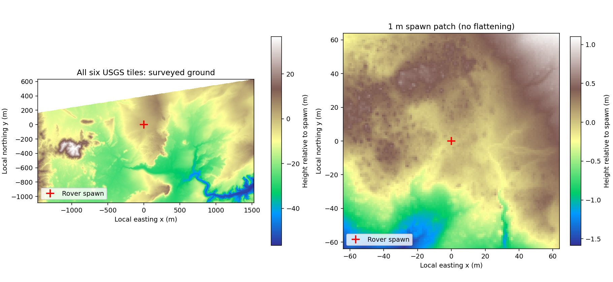

# Imported Southern Utah survey terrain

The normal `rover_desert.launch.py` now defaults to `world:=usgs`. The six
user-provided USGS LPC Southern Utah 2018 / LAS 2019 LAZ files replace the
synthetic Mars environment. The rover, steering/drive controller, keyboard,
watchdog, stereo camera and LiDAR configuration are unchanged.

## Run

From a regular Ubuntu terminal:

```bash
cd ~/rover_ws
source /opt/ros/humble/setup.bash
colcon build --packages-select rover_sim rover_planner
source ~/rover_ws/install/setup.bash
env -u GTK_PATH -u GTK_EXE_PREFIX -u GIO_MODULE_DIR -u GTK_IM_MODULE_FILE \
  ros2 launch rover_sim rover_desert.launch.py rviz:=true
```

Your reduced LiDAR settings remain available without rebuilding:

```bash
env -u GTK_PATH -u GTK_EXE_PREFIX -u GIO_MODULE_DIR -u GTK_IM_MODULE_FILE \
  ros2 launch rover_sim rover_desert.launch.py rviz:=true \
  lidar_profile:=lite lidar_samples:=180 lidar_rate:=3
```

Use one launch at a time. Teleop is still a separate sourced terminal running
`ros2 run rover_sim rover_teleop`: W/S forward/backward, A/D rotate, Space
stop, Ctrl+C stop/exit. The original environments remain selectable using
`world:=mars` or `world:=desert`.

### Snap IDE GUI workaround

If launching from the Snap IDE produces a GLib `antialiasing` schema error,
use a regular Ubuntu terminal. In that IDE terminal, the following process-local
command clears the inherited GTK/schema paths and selects system data/X11.
It does not change desktop settings or shell startup files:

```bash
env -u GTK_PATH -u GTK_EXE_PREFIX -u GIO_MODULE_DIR -u GTK_IM_MODULE_FILE \
  -u GSETTINGS_SCHEMA_DIR -u GDK_PIXBUF_MODULE_FILE \
  XDG_DATA_DIRS=/usr/local/share:/usr/share:/var/lib/snapd/desktop \
  QT_QPA_PLATFORM=xcb QT_STYLE_OVERRIDE=Fusion \
  ros2 launch rover_sim rover_desert.launch.py rviz:=true
```

`gui:=true` (the default) opens the Gazebo Fortress GUI. To look at a sim
started with `gui:=false`, run `ros2 run rover_sim gazebo_gui` in a sourced
terminal (same `IGN_PARTITION`, if one is set): it sets the model path, puts the
window on the left half of the screen and points the camera at the rover.
A bare `ign gazebo -g` leaves the camera at the world origin, about 400 m from
the hills spawn, where no chunks are loaded, so it shows only sky.

## Data, scale and surface reconstruction

All **47,893,699 points** were streamed; **33,726,963 class-2 ground returns**
contribute to the terrain. Withheld points and other classifications are
excluded from ground elevation. The source files are read only and are not
required at runtime: the portable generated meshes, grids and world ship
inside this package. The originals are not duplicated into the repository.

[worlds/usgs.terrain.json](../worlds/usgs.terrain.json) records each input
basename, SHA-256, point/class counts and bounds, plus CRS WKT, processing,
the local origin and mesh checksums. The source files are:

- `USGS_LPC_UT_Southern_QL1_2018_12SWH1851_LAS_2019.laz`
- `USGS_LPC_UT_Southern_QL1_2018_12SWH1852_LAS_2019.laz`
- `USGS_LPC_UT_Southern_QL1_2018_12SWH1951_LAS_2019.laz`
- `USGS_LPC_UT_Southern_QL1_2018_12SWH1952_LAS_2019.laz`
- `USGS_LPC_UT_Southern_QL1_2018_12SWH2051_LAS_2019.laz`
- `USGS_LPC_UT_Southern_QL1_2018_12SWH2052_LAS_2019.laz`

The compound CRS is NAD83(2011) / UTM 12N (horizontal EPSG:6341) plus
NAVD88 / Geoid12B elevations, all in metres. Gazebo local x is easting,
y northing and z up. The coordinate translation is:

```text
projected_easting  = local_x + 519472.000
projected_northing = local_y + 4252088.000
NAVD88_elevation   = local_z + 1394.008
```

There is no scale change, vertical exaggeration, rotation or flattening.
The full bounding rectangle is 3000 × 1720 m, with an irregular northern
survey boundary. About 4.48 km² of ground nodes are supported. Reconstructed
elevations span approximately 1337.574–1430.606 m. Large absolute survey
coordinates are removed to preserve simulator numerical precision.

The world contains **294 static triangle-mesh tiles / 587,784 triangles**.
The background uses 4 m grid spacing; a 128 × 128 m patch around spawn uses
1 m spacing. Small ground gaps are filled only within observed survey
coverage and within 8 m of a ground observation. Unsupported regions remain
open; no flat floor is invented outside the survey.

Each grid node uses a local least-squares ground plane, with a mean-height
fallback for sparse, ill-conditioned or strongly extrapolated fits. This
avoids isolated plane-fitting spikes. Fine-patch edges blend to the coarse
surface over 4 m and have matching boundary heights. Tiles use identical
visual and collision meshes, counterclockwise upward-facing triangles,
and the existing 0.8 ground friction. A synthetic regolith texture is reused
from the existing package; it is not aerial imagery or measured ground color.

The default spawn lies on a measured 0.595° coarse slope (maximum nearby
coarse slope 1.228°). `z:=auto` evaluates the exact exported terrain triangles
at launch x/y and adds the existing 0.36 m rover spawn clearance. Explicit
`z:=...` remains available. An automatic spawn outside supported terrain is
rejected. The query gives a starting height, not a guarantee that arbitrary
slopes/ledges support a safe rover pose.

The converter uses a mesh rather than a Gazebo heightmap (the project saw
CPU ray/heightfield stalls with heightmaps under Classic). On Fortress the
world uses the shared header from `rover_sim/fortress_world.py` (DART with the
Bullet collision detector, 1 ms step, the same systems and GUI as the Mars
and desert worlds). The 294 meshes keep their own COLLADA texture
(`ground.png`), and no new sensor, controller or physics plugin is added.



## Terrain chunks (render distance)

By default (`chunks:=true`) the usgs world does not load all 294 tiles. The
launch cuts them into **16 m chunks** (17,543 of them, the same 587,784
triangles, the tile normals and UVs kept so edges shade without seams) and
puts only the chunks within `chunk_radius` (default **8**) chunks of the rover
in the world, a 17 × 17 square (272 m, past the 100 m LiDAR range). At the
hills site that is 289 chunks and about 9,200 triangles instead of 587,784.

The `terrain_chunks` node (`rover_sim/terrain_chunks.py`) follows
`/ground_truth/odom`: chunks that come into range are spawned nearest first
through `/sim/spawn_entity`, and chunks more than `chunk_radius + 2` away are
removed through `/sim/delete_entity` (the margin stops a chunk flickering in
and out at an edge). It logs `Chunks +N -M: K loaded around chunk (ix, iy)`.

The chunk meshes are not in the repository (about 140 MB of COLLADA): the first
launch builds them into `~/.cache/rover_sim/usgs_chunks/<hash>/` in about 5 s
and later launches reuse them; a change to the tiles (`usgs.terrain.json`)
gives a new hash. The launch fills `worlds/usgs_chunked.world` (the usgs world
without tiles, written by `import_usgs_terrain.py --world-only`) with the
chunks around the spawn. Use `chunks:=false` for the whole survey, e.g. for
`validate_survey_terrain.py` far from the spawn, and `chunk_radius:=N` to
change the render distance.

## Test sites and rocks

`config/usgs_sites.yaml` names the spawn sites; `site:=` picks one and
`x:=`/`y:=`/`yaw:=` override it:

| Site | x, y (m), yaw | What is there |
| --- | --- | --- |
| `hills` (default) | −396, 52, facing 210° | Foot of a hill: under 3° at the rover; ahead the ground climbs 9.2 m in 40 m (12.8° mean, 19° max); 83 synthetic rocks |
| `flat` | 0, 0, 0 | The importer's spawn: flattest point, 1 m mesh patch, no rocks |

The hills ground is the 4 m mesh, so small bumps are smoothed; the rocks
supply the small obstacles. They reuse the Mars rock meshes (40 pebbles,
35 rocks, 8 boulders up to about 0.6 m tall, within 20 m and outside 3 m of
the spawn, none on ground steeper than 25°), are buried to their downhill
edge, and are listed in `worlds/usgs_rocks.json`. After editing the YAML run
`python3 scripts/import_usgs_terrain.py --world-only` and rebuild.

With the GUI on, `gazebo_gui` moves the Gazebo camera to 7 m behind and 4 m
above the rover once it is spawned (`/gui/move_to/pose`); the camera stays free
to orbit.
`validate_survey_terrain.py` needs `site:=flat`: rocks would count as
LiDAR-versus-survey errors.

## Recreate the assets

Conversion dependencies are optional and isolated from ROS Python. A clean
machine needs the Ubuntu venv package once:

```bash
sudo apt install python3-venv
python3 -m venv ~/.local/share/rover_sim/terrain-venv
~/.local/share/rover_sim/terrain-venv/bin/python -m pip install \
  -r ~/rover_ws/src/rover_sim/rover_sim/requirements-terrain.txt
```

With all six originals in `~/Downloads`, run from the package directory:

```bash
cd ~/rover_ws/src/rover_sim/rover_sim
~/.local/share/rover_sim/terrain-venv/bin/python scripts/import_usgs_terrain.py \
  ~/Downloads/USGS_LPC_UT_Southern_QL1_2018_12SWH{1851,1852,1951,1952,2051,2052}_LAS_2019.laz
```

The defaults are `--spacing 4 --local-spacing 1 --tile-size 128`. The script
validates matching metric coordinate systems and rejects duplicate inputs.
It recreates only the USGS asset directory/world/manifest. To rewrite only
`worlds/usgs.world` from the tiles in `worlds/usgs.terrain.json`, for example
after a change to the shared Fortress header, run
`python3 scripts/import_usgs_terrain.py --world-only` (no LAZ files or venv
needed). Rebuild from
`~/rover_ws` after regenerating assets. Normal operation uses the ROS setup
and installed workspace, not the conversion venv.

## Validation

Unit tests check plane reconstruction, sparse-fit stability, coverage/holes,
triangle orientation, exact height interpolation, fine/coarse seams, all six
source identities, spawn behavior and the default launch. Run the normal
workspace `colcon test --packages-select rover_sim rover_planner` and
`colcon test-result --verbose`.

For integration, use an unused `ROS_DOMAIN_ID` and `IGN_PARTITION` and no teleop/planner or
other command publisher. The validator moves the rover and inserts/removes
one temporary measurement box. Terminal 1 after building:

```bash
source /opt/ros/humble/setup.bash
source ~/rover_ws/install/setup.bash
export ROS_DOMAIN_ID=60
export IGN_PARTITION=usgs_check
env -u GTK_PATH -u GTK_EXE_PREFIX -u GIO_MODULE_DIR -u GTK_IM_MODULE_FILE \
  ros2 launch rover_sim rover_desert.launch.py gui:=false rviz:=false site:=flat
```

Terminal 2:

```bash
source /opt/ros/humble/setup.bash
source ~/rover_ws/install/setup.bash
export ROS_DOMAIN_ID=60
export IGN_PARTITION=usgs_check
ros2 run rover_sim validate_survey_terrain.py \
  --output ~/rover_ws/src/rover_sim/rover_sim/docs/validation/local_usgs_simulation.json
```

The required JSON output includes spawn/rate/RTF, resting drift, wheel-ground
gaps, chassis clearance, LiDAR-versus-mesh errors, a 5 m box-face check,
forward/backward/left/right/no-strafe checks and watchdog epochs. Add
`--expected-rate 3` if Terminal 1 uses `lidar_rate:=3`. Stop the isolated
launch afterward and unset `ROS_DOMAIN_ID` and `IGN_PARTITION` before normal operation.

Limitations: this is bare-earth terrain, not a reconstruction of trees,
buildings, water physics or overhangs. Four-metre background sampling loses
small obstacles; 1 m sampling is still coarse relative to wheel contact.
Terrain is rigid with approximate friction. Survey coverage has open edges.
Large-world traversal, high-speed/slope mobility and planner performance
over the entire survey are not established by local prototype checks.
