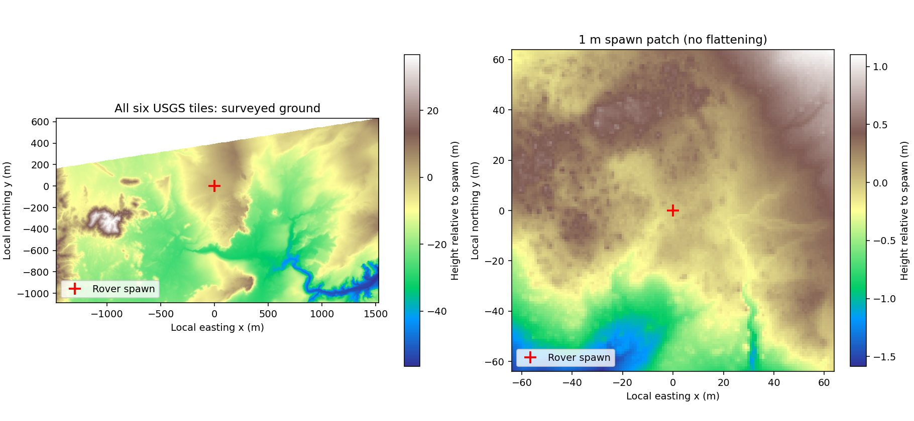
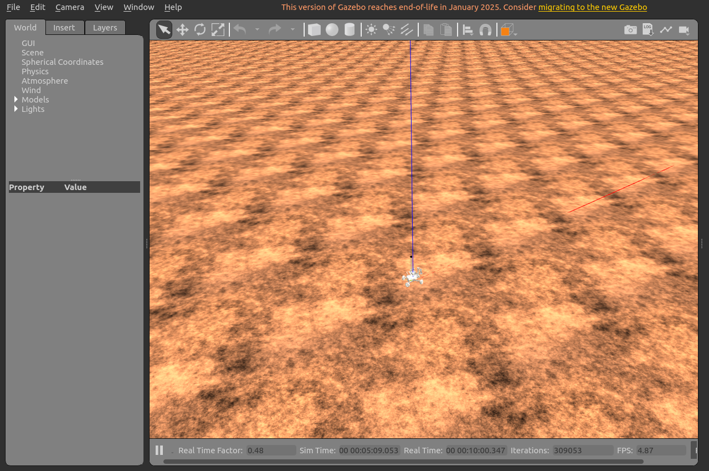
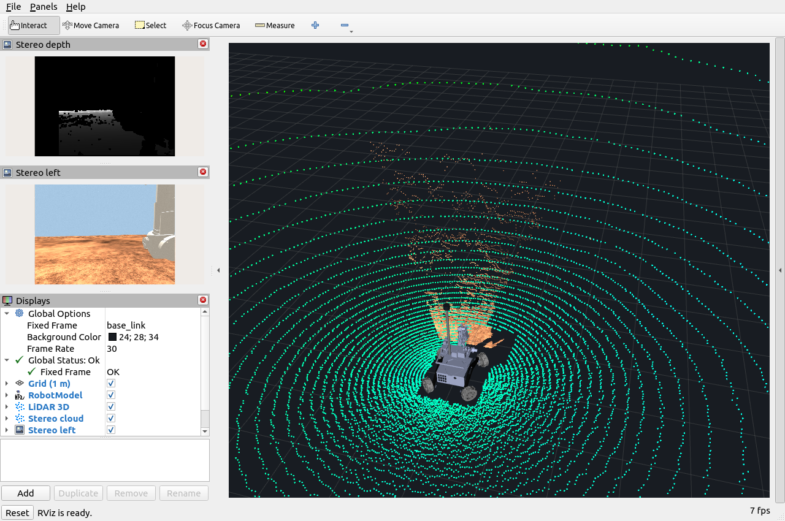

# USGS terrain integration — 2026-11-21

## Gazebo Fortress re-run (Silvio-Fortress, 2026-11-21)

The world was ported to Fortress (shared `fortress_world.py` header, DART +
Bullet, unique collision/visual names; tiles and meshes unchanged) and
`validate_survey_terrain.py` was moved to the `/sim/*` ros_gz services. One
headless run (`gui:=false`, default real rover, 3D LiDAR at 5 Hz, stereo on,
`ROS_DOMAIN_ID=73`, `IGN_PARTITION=usgs_check`) passed **13/13**
([JSON](usgs_simulation_fortress.json)):

| Check | Result |
| --- | --- |
| Spawn, raw cloud rate, RTF | 5.00 Hz, RTF 0.997 |
| Resting drift / base z std | 0.35 mm / 0.004 mm |
| Wheel-bottom gap to survey | 0.15–0.27 mm |
| Chassis clearance | 0.111 m |
| LiDAR vs survey mesh (start / after driving) | median 11.5 / 10.8 mm, p95 69 / 77 mm |
| 5 m box face | 494 returns, median 12.2 mm |
| Forward / backward 2 s at 0.2 m/s | +0.392 / −0.389 m, lateral ≤ 2 mm |
| Yaw left / right 2 s at 0.3 rad/s | +0.49 / −0.59 rad |
| Blocked strafe, watchdog epoch | no motion, epoch unchanged |

No mesh or texture load errors appeared in the server log. The Classic
results below are kept as recorded.

## Original Classic integration

The six user-supplied LAZ tiles were made the default Gazebo Classic world.
Their originals remain unchanged. [Conversion and launch guide](../usgs_terrain.md)
contains copyable build/run/regeneration commands; the
[data manifest](../../worlds/usgs.terrain.json) records source SHA-256 values,
CRS, coordinate origin, classifications, grids and mesh checksums.

## Reconstruction

- 47,893,699 source points; 33,726,963 non-withheld class-2 ground returns.
- NAD83(2011) / UTM 12N (EPSG:6341) plus NAVD88/Geoid12B, metres.
- Origin: easting 519472 m, northing 4252088 m, elevation 1394.008 m.
- Bounding rectangle 3000 × 1720 m; irregular survey footprint, approximately
  4.48 km² of supported ground nodes. No terrain outside that coverage.
- 4 m background grid, 1 m grid on the 128 × 128 m spawn tile, stitched edges.
- 294 tiled visual/collision meshes, 587,784 triangles, approximately 47 MB
  generated assets. Reconstructed elevation range 1337.574–1430.606 m.
- No vertical exaggeration, reshaping or flattened spawn. Local origin is on
  measured approximately 0.595° terrain (nearby coarse maximum 1.228°).
- Synthetic texture reused from the existing package, not aerial imagery.

Sparse plane fits initially produced isolated extrapolation spikes. The
converter now requires adequate count/spread and conditioning, and falls back
to measured mean height for unstable fits. A deterministic regression covers
this case. The final 1 m patch spans only −1.583–1.101 m relative to spawn.

## Build and unit tests

Normal `~/rover_ws` build of `rover_sim` and `rover_planner` passed.
All **427 unit tests** pass: 357 simulation tests (including 24 new survey
tests) and 70 planner tests. Colcon reports **441 results**, including its
14 CTest wrappers; zero failures/errors/skips.

The new tests check metric plane reconstruction, sparse-fit stability,
ground versus non-ground input, bounded hole filling, unsupported coverage,
triangle winding and exact triangle interpolation, fine/coarse seam matching,
all six source identities, default/explicit spawn behavior and default launch.
Existing controller, kinematics, teleop, sensor and planner tests are retained.

## Gazebo checks

[Measured results](usgs_simulation.json): **13/13 checks passed**, using the
real rover and the unmodified default stereo + Airy 3D LiDAR configuration.
ROS domain 60 and Classic master port 11370 isolated the run; no keyboard or
planner command publisher was active. Validation used the existing ground
truth topic for measurements, without adding a new TF/odometry source.

| Check | Measured result |
| --- | --- |
| Spawn and scan | Correct world; raw 4.9964 Hz simulation time; measured headless RTF 0.6433 |
| Rest over 3 simulation seconds | XY drift 0.01043 m; base-height stddev 0.000056 m |
| Wheel contact | Wheel-bottom minus terrain between −0.00092 and −0.00064 m |
| Chassis clearance | Minimum 0.1102 m |
| LiDAR versus actual mesh before motion | 666 sampled points; median vertical error 0.00331 m; 95th percentile 0.01341 m |
| Known 5 m box face | 197 returns; median face error 0.01569 m |
| Forward | 0.3847 m; lateral drift 0.00159 m |
| Backward | −0.3931 m; lateral drift −0.00149 m |
| Left / right yaw | +0.4818 / −0.5764 rad |
| Prohibited lateral command | Approximately 0.0000058 m translation; drive remained blocked |
| LiDAR after motion | 667 sampled points; median vertical error 0.00313 m; 95th percentile 0.01461 m |
| Watchdog during measured checks | Epoch unchanged |

LiDAR residuals compare transformed raw returns against the same piecewise
triangles used by Gazebo, not a bilinear approximation or a nominal plane.
The known-distance check inserts one static box and removes it afterward.

The world and real rover took about 50 seconds to become ready. Two watchdog
expiry warnings occurred during startup, and two more occurred later during
the long GUI/debugging session, outside the 13-check interval. The 0.3 wall-
second watchdog and control logic were not changed. Heavy host load remains
a timing limitation; this is not proof of arbitrary-load reliability.

## Visual verification

[Gazebo screenshot](usgs_gazebo.png): the surveyed mesh and real rover render.
[RViz screenshot](usgs_rviz.png): RobotModel, live 3D LiDAR rings, stereo cloud,
left image and depth view render together; local `base_link` fixed-frame
status is OK. Screenshots show only a temporary nested display; no other
desktop windows were captured. All owned test windows/simulation are stopped.

GUI debugging found the inherited Snap/GTK environment could crash with
`Settings schema ... xsettings ... antialiasing`. Clearing GTK/schema paths,
using system `XDG_DATA_DIRS` and selecting X11/Fusion allowed both GUIs to
run. A plain standalone `gzclient` also lacked package model paths; launching
it through `gazebo_ros` resolved that. The guide documents both workarounds.
These are process-local changes, not changes to global desktop settings.
RViz's unsupported-stereo message and Gazebo's end-of-life banner are expected.

## Practical limits

This is a bare-earth terrain model. Trees/buildings and other non-ground
returns, water physics, caves and overhangs are not reconstructed. Small
terrain features are lost at 4 m / 1 m sampling; wheel-scale roughness and
real sand interaction are not represented. Survey edges/large gaps are open,
not an infinite ground plane. Full-survey navigation, long-duration parking,
steep-slope mobility and high-speed driving are not established by local
prototype checks. The plot/mesh is not an orthophoto.
